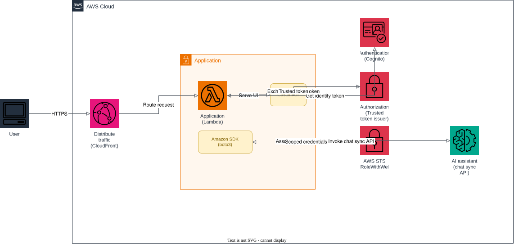

# AWS Project: AI Assistant with Custom UI

Create a custom chat UI that authenticates users through an identity provider, federates that identity into AWS via a trusted token issuer, and assumes a tightly scoped IAM role before calling a managed AI assistant's chat API — so the assistant is only ever reachable with short-lived, least-privilege credentials.

1. a user connects over HTTPS to CloudFront (distribute traffic), which routes the request to the Application;
2. the Application (`application` Lambda) serves the Custom UI and, using the Amazon SDK (boto3), drives the identity flow;
3. the Application authenticates the user against Cognito (Authentication) to obtain an identity token;
4. the Application exchanges that identity token through a call to the trusted token issuer (Authorization, modeled with an IAM OIDC identity provider that trusts the Cognito user pool) to get back a trusted token;
5. using the trusted token, the Application calls AWS STS `AssumeRoleWithWebIdentity` to assume the scoped `ai-assistant-access` IAM role and receive temporary, least-privilege credentials;
6. with those credentials, the Amazon SDK calls the chat sync API of the AI assistant (`ai_assistant` Lambda), whose response flows back through the Application and Custom UI to the user.

## Prerequisites

- Docker
- Terraform 1.5+
- AWS CLI

## Start Floci

```bash
docker compose up -d
```

## Apply Terraform

```bash
terraform init
terraform apply
```

Applying:

- creates the Cognito user pool and app client (`authentication`) that acts as the identity provider;
- creates the IAM OIDC identity provider that trusts the Cognito user pool and models the trusted token issuer (`authorization`), plus the scoped `ai-assistant-access` IAM role it can assume via `AssumeRoleWithWebIdentity`;
- deploys the `ai-assistant` Lambda (the chat sync API), only invokable by principals holding the scoped role's temporary credentials;
- deploys the `application` Lambda (with a public Function URL) that serves the rendered [web/index.html.tftpl](web/index.html.tftpl) Custom UI and performs the full authenticate → exchange → assume-role → invoke flow;
- creates the CloudFront distribution that distributes traffic to the Application's Function URL.

## Architecture



The diagram source is a real, editable [draw.io](https://www.drawio.com/) file at [docs/architecture.drawio](docs/architecture.drawio), generated programmatically with the [drawpyo](https://github.com/MerrimanInd/drawpyo) Python library. Open the `.drawio` file directly on GitHub or with the draw.io desktop app / [app.diagrams.net](https://app.diagrams.net/) to edit it.

To regenerate the diagram (`.drawio` source + the `.svg`/`.png` embedded above) after changing the architecture:

```bash
python3 -m venv .diagram-venv
.diagram-venv/bin/pip install drawpyo
.diagram-venv/bin/python scripts/generate_diagram.py

# rasterize the .drawio file to svg/png (used by the README) via headless draw.io
docker run --rm -v "$PWD/docs":/data -w /data rlespinasse/drawio-export -f svg -o . --output-mode relative --remove-page-suffix .
docker run --rm -v "$PWD/docs":/data -w /data rlespinasse/drawio-export -f png -o . --output-mode relative --remove-page-suffix -t .
```

## Create a test user

```bash
USER_POOL_ID=$(terraform output -raw cognito_user_pool_id)
CLIENT_ID=$(terraform output -raw cognito_client_id)

aws --endpoint-url http://localhost:4566 cognito-idp sign-up \
  --client-id "$CLIENT_ID" --username jane --password 'Passw0rd!'

aws --endpoint-url http://localhost:4566 cognito-idp admin-confirm-sign-up \
  --user-pool-id "$USER_POOL_ID" --username jane
```

## Chat with the assistant

```bash
APP_URL=$(terraform output -raw application_function_url)

curl -s -X POST "$APP_URL" \
  -H "Content-Type: application/json" \
  -d '{"username": "jane", "password": "Passw0rd!", "prompt": "What can you help me with?"}' | jq
```

## Open the Custom UI

```bash
open "https://$(terraform output -raw cloudfront_domain_name)"
```

If you want to follow the execution, watch the Floci container logs:

```bash
docker compose logs -f floci
```

## Clean up

```bash
terraform destroy
docker compose down
```
